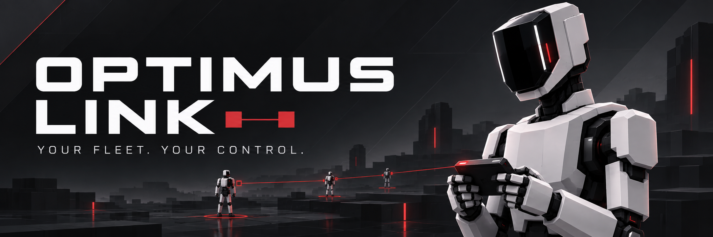
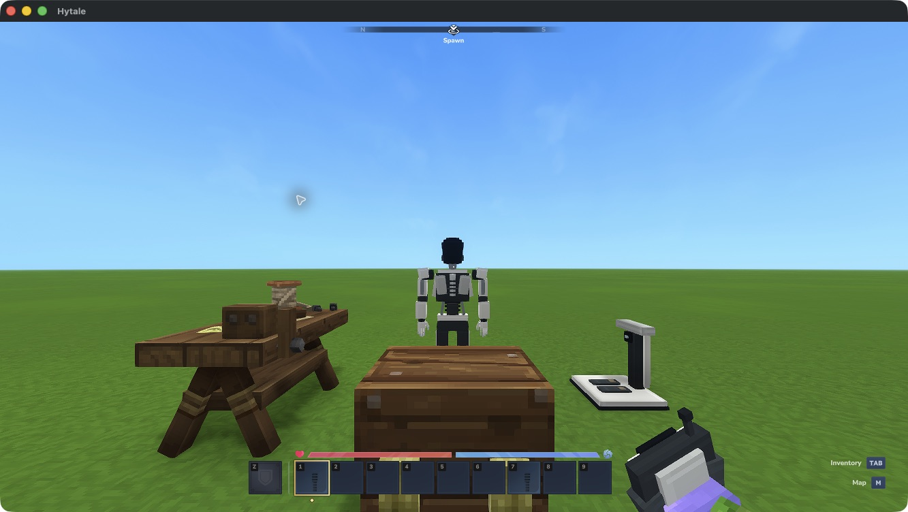
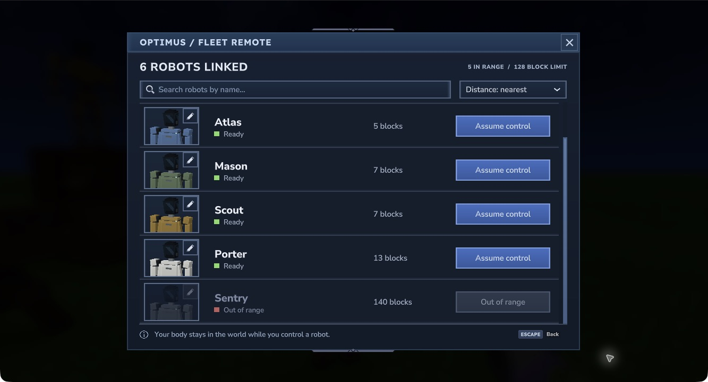
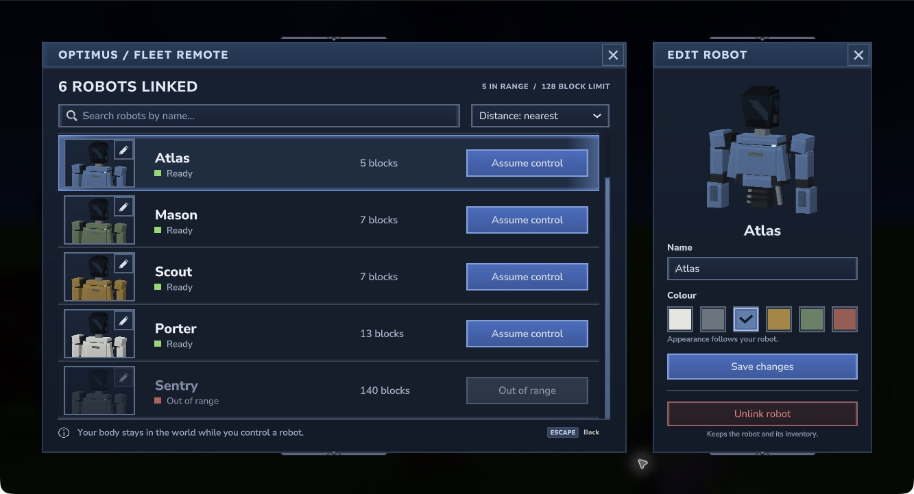

# Optimus Link

[Player guide](https://jkswoods.github.io/optimus-link/) · [Development releases](https://github.com/jkswoods/optimus-link/releases)



Craft humanoid robots, link them to a Fleet Remote and control them one at a time, each with its own tools and inventory.



*Build your first fleet: Workbench on the left, storage in the centre, Assembly Dock on the right and a deployed robot behind them.*

- Craft the Assembly Dock, Fleet Remote and robot deployment units.
- Link several robots to one remote; search by name, sort by distance and choose which to control.
- Name and recolour robots through their portrait editor, with saved individual appearances.
- Walk, look, jump, mine, place and use equipment through your robot.
- Keep separate tools, equipment and storage on every robot.
- Return to your body with **Release Control in hotbar slot 1**, then right-click; the control cannot be moved or dropped on death.

[Install](https://jkswoods.github.io/optimus-link/hytale0.7/installation/) · [Your first session](https://jkswoods.github.io/optimus-link/hytale0.7/getting-started/) · [Recipes](https://jkswoods.github.io/optimus-link/hytale0.7/recipes/) · [Fleet controls](https://jkswoods.github.io/optimus-link/hytale0.7/fleet/) · [Screenshots](https://jkswoods.github.io/optimus-link/hytale0.7/gallery/)

## Choose your robot



*The native handset in Hytale 0.7.4. Search and sort the roster, then use a portrait’s pencil to edit its name and colour. Out-of-range robots remain visible with control and editing disabled.*



The [player guide](https://jkswoods.github.io/optimus-link/) covers [inventories and recovery](https://jkswoods.github.io/optimus-link/hytale0.7/inventory/) and [troubleshooting](https://jkswoods.github.io/optimus-link/hytale0.7/troubleshooting/). The Assembly Dock crafts equipment without fuel or power; charging and autonomous jobs are outside this version.

## Development status

This **Hytale 0.7 support branch** uses **Java 25**, with singleplayer confirmation of the control-return fixes. Choose downloads by their exact game-patch requirements. Use a disposable test world. Some animation transitions, human sound listening and actual second-client play remain under review. See [compatibility and backups](https://jkswoods.github.io/optimus-link/hytale0.7/compatibility/) before testing.

The banner is original mod artwork. Screenshots are native development captures; older captures do not establish acceptance of later animation or multiplayer changes.

## Build

Use your own server JAR and JDK 25. The dependency fingerprint must match `target.json`; Hytale files are not redistributed.

```sh
python3 tools/build.py --server PATH_TO_HYTALE_SERVER_JAR --jdk PATH_TO_JDK_25 --test
```

The build prints the mod JAR filename under `build/`. Focused tests cover authority, inventory preservation, safe exits and native transport behavior. They do not replace gameplay verification.

## Documentation

The [versioned player guide](https://jkswoods.github.io/optimus-link/) is maintained on the separate [`docs` branch](https://github.com/jkswoods/optimus-link/tree/docs). In that checkout, run `npm ci --ignore-scripts`, `npm run build` and `npm run check`. Select `docs` when manually dispatching its Pages workflow.

To create a development bundle, supply the separately built guide with `python3 tools/package.py --jar BUILD.jar --site PATH_TO_DOCS_SITE`.

Original models, animations and connected ElevenLabs audio are included. The operator's body remains exposed under normal world damage rules while controlling a robot.

No redistribution license has been selected. This independent fan mod is not affiliated with Tesla or Hytale.

## Compatibility and builds

Current source targets Hytale `>=0.7.3 <0.8.0` and uses the `hytale0.7` support branch. See [build and release instructions](https://jkswoods.github.io/optimus-link/hytale0.7/build-and-release/) for the SDK pin, candidate checks, versioned filenames and CurseForge workflow.

## Contributing

See [the contribution guide](CONTRIBUTING.md) for feature and bug-fix PR targets.
Maintainers handle forward/back ports, and support-branch PRs require owner approval.

The player guide follows the Hytale support line and is updated independently of mod releases. Select downloads by their game compatibility and read the selected file’s release notes for included changes and artifact checksums.

## Optimium development

The development source adds small Optimium veins to newly generated ordinary underground stone, raw ore drops and a one-to-one Furnace recipe for Optimium Ingots. Native mining, fuelled smelting and normal reload have been checked, and the revised ore and ingot appearance has been approved. Human sound listening and actual second-client checks remain open. Choose a compatible file and read its release notes for included features.

## Range Extender development

Craft a 2.5-block signal mast at the Optimus Assembly Dock using 6 Optimium Ingots, 4 Iron Ingots and 4 Copper Ingots. Place your Fleet Remote in its linking slot for six seconds, then take the same item back. A mast can link several remotes.

Each mast reaches 128 blocks and can relay through other masts linked to the same remote. High cyan arcs show connections. While you hold that remote within the network, the server activates covered original robots so they can become ready beyond normal loading range; putting it away or leaving coverage releases the temporary loading holds. This loading path is undergoing native verification in the local development build.
