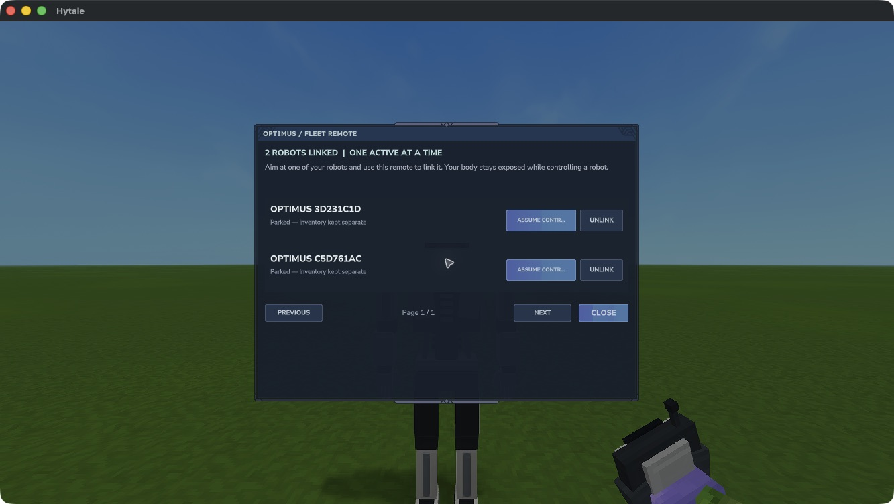
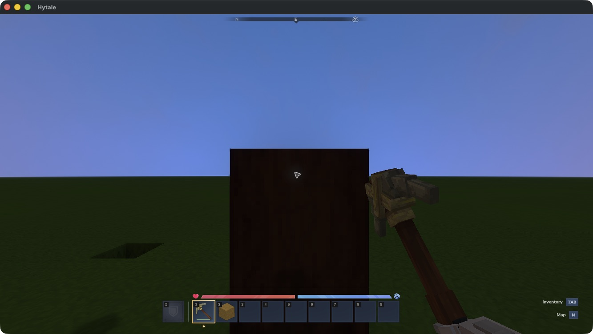

# Fleet and controls

These controls are implemented in 0.2.0-dev. Linking, views, inventory handling, mining, placement and manual return have native evidence; chest interactions have also passed. Walking, looking, jumping and the remaining failure exits still need gameplay verification.

## Link robots

Use the Fleet Remote's secondary action while aiming at one of your robots within 5 blocks. One robot can link to **one remote**; one remote can link to **many robots**. The roster shows three rows per page, with Previous and Next buttons.

Robots belong to the player who deployed them. A remote binds to its first user and world. Trading it does not transfer ownership, and another player cannot use it to take your robots.

Use **Unlink** in the original remote's roster to free a parked robot for another remote. Unlinking keeps its ownership, equipment and storage. Active control must end first.

An actual development-build roster after linking two robots to one remote. Inventory handling, mining, placement, manual return and a nonempty inventory through controlled disconnect and normal reload have native evidence. Chest interactions with empty hands or a held tool and transfers in both directions have also passed. Walking, looking and jumping remain under verification.

[Open the roster image at full size](assets/native/fleet-two-robots.jpg).

## Assume control

Choose **Assume control** beside a loaded robot within 32 blocks of your body. Your body stays in place under normal damage rules. The robot uses the operator's existing permissions and game mode; it does not grant extra permissions.

| Action | Control |
| --- | --- |
| Walk, look and jump | Your normal game bindings |
| Mine, place and use held equipment | Your normal item actions, using the robot's held item |
| Open storage and move items | Your normal inventory binding, using robot-owned containers |
| Return to your body | `/optimus-release` |
| List your robots in this world | `/optimus-list` |
| Recover a lost remote link | `/optimus-recover ROBOT_ID` while within 5 blocks of the parked robot |

Native pickup and transfers between a robot's hotbar and storage have passed. A robot has mined a dirt block with a crude pickaxe, collected the dirt into its own hotbar and placed it against a support using normal item actions. A controlled robot has also opened a chest with empty hands or a held pickaxe and moved tools and blocks through its inventory in both directions. Walking, looking and jumping remain under gameplay verification.

*Actual 0.2.0-dev view after mining and pickup. Select the collected block in the robot's hotbar to place it. This check used a prepared target and does not establish walking, looking or jumping.*

## Safe exits

Manual release and leaving control range have restored the operator view, selected slot and immediately usable remote in native checks. Controlled disconnect followed by normal reload preserved separate inventories. Chunk unloading and the operator’s world-change exit have passed focused native checks. Both robots, their inventories and links survived a subsequent controlled disconnect and normal reload. Robot destruction has also passed a focused native check and normal reload.

Operator death has also passed a focused native check after repairing a prematurely closed respawn page. Control returned to the body, the normal Respawn button worked and both original remotes could be picked up from their world drops. Both robots' equipment and links survived a subsequent normal reload. Keep your body protected; the world's normal death loss rules still apply. If the robot dies, control returns to your body and the destroyed robot leaves its roster. Its inventory contents become normal world drops, with no deployment-unit refund. A focused native check removed the robot, preserved the other robot and both remotes, and recovered the original equipped tool once after normal reload.

**Release control before changing worlds.** The operator’s world-change exit has passed a focused native check after repairing a defect in an earlier development build. A separate native transfer request on the controlled robot was blocked: control returned to the operator, both robots stayed in their original world and the first robot could be controlled again with its tool intact. Robots and bound remotes belong to their original world; this version does not provide fleet migration. Delayed output from a released robot is discarded so it cannot replace the returned body's inventory view.

There is one active robot per operator. Release the current robot before selecting another. No control session is restored after a server restart.
