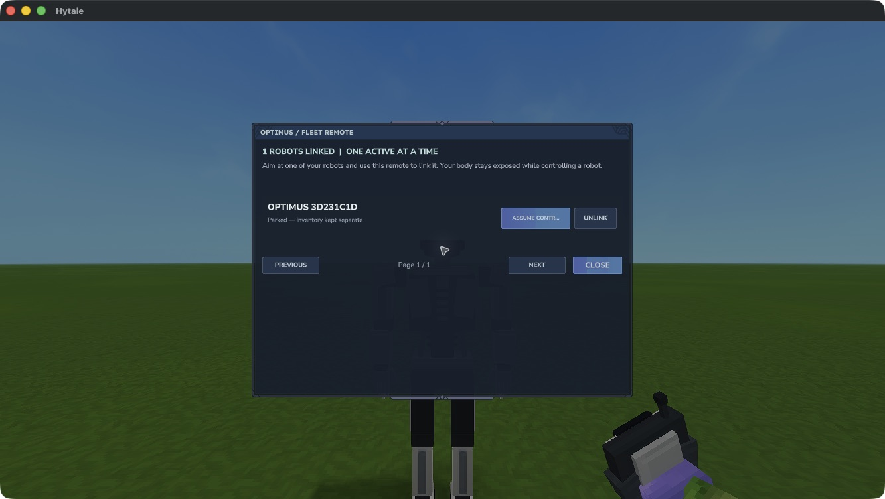

# Fleet and controls

The following controls are implemented in 0.2.0-dev and await native gameplay verification.

## Link robots

Use the Fleet Remote's secondary action while aiming at one of your robots within 5 blocks. One robot can link to **one remote**; one remote can link to **many robots**. The roster shows three rows per page, with Previous and Next buttons.

Robots belong to the player who deployed them. A remote binds to its first user and world. Trading it does not transfer ownership, and another player cannot use it to take your robots.

Use **Unlink** in the original remote's roster to free a parked robot for another remote. Unlinking keeps its ownership, equipment and storage. Active control must end first.

The native Fleet Remote roster in 0.2.0-dev, with one robot linked. Control and the complete gameplay loop remain under verification.

[Open the roster image at full size](assets/native/fleet-roster.jpg).

## Assume control

Choose **Assume control** beside a loaded robot within 32 blocks of your body. Your body stays in place under normal damage rules. The robot uses the operator's existing permissions and game mode; it does not grant extra permissions.

| Action | Control |
| --- | --- |
| Walk, look and jump | Your normal game bindings |
| Mine, place and use held equipment | Your normal item actions, using the robot's held item |
| Open storage and move items | Your normal inventory binding, using robot-owned containers |
| Return to your body | `/optimus-release` |
| List your robots in this world | `/optimus-list` |
| Recover a lost remote link | `/optimus-recover ROBOT_ID` while within 5 blocks of the parked robot |

Mining, placement, interactions and inventory use are intended to pass the game's server checks. These paths are not yet accepted from a real client in the development build.

## Safe exits

Manual release clears the active control session and restores the operator view. The implementation also ends control when a participant becomes unavailable, dies, changes world, leaves range or disconnects. Those lifecycle cases require native verification before relying on this build in a valued world.

Robots remain in their original world. The candidate handles a world-transfer request from a controlled robot by releasing control and returning you to your body. This transfer guard still awaits native verification. Delayed output from a released robot is discarded so it cannot replace the returned body's inventory view.

There is one active robot per operator. Release the current robot before selecting another. No control session is restored after a server restart.
