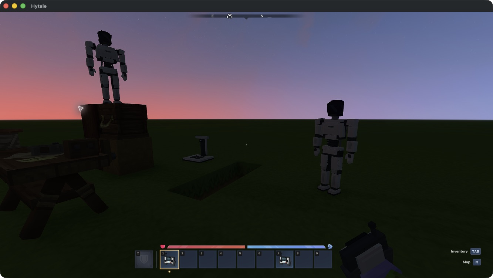
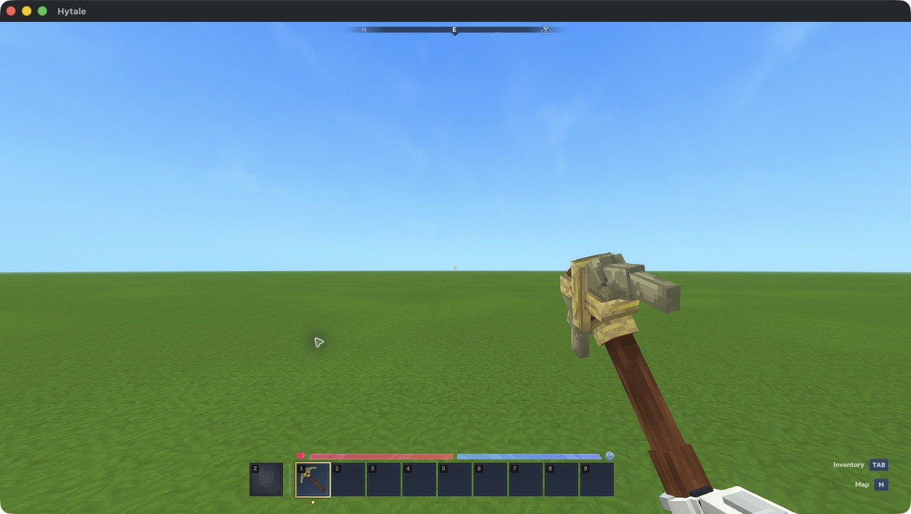
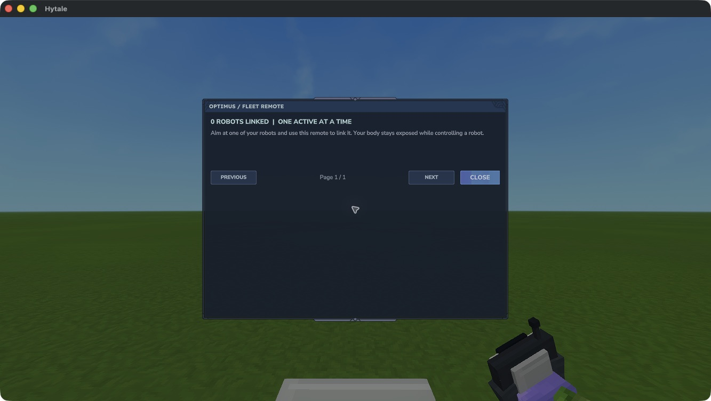

# Inventory and recovery

Each robot keeps its own **36 storage slots**, native equipment containers and **9-slot hotbar**. Taking control shows that robot's possessions. Releasing it returns you to your own inventory and leaves its equipment with the robot.

## Release control

During possession, **slot 1 is permanently reserved for Release Control**. Select it with your hotbar bindings, normally **1**, then right-click to return to your body. Selecting it alone keeps control active. Slots **2–9** hold real equipment. The virtual control cannot be moved or dropped, including on death.

If slot 1 already contains an item, that item moves to a free robot hotbar or storage slot with its quantity, durability and metadata preserved. If neither has room, free one slot before assuming control.

*Current remote thumbnails in the operator's inventory. The release control appears in slot 1 while controlling a robot.*

## Equipment

Open the robot's inventory to equip tools and blocks in slots 2–9. Mining, placement, pickup and chest transfers use its possessions and normal game rules. A parked robot retains its equipment and storage through normal save/reload.

*Earlier native grip check, before slot 1 was reserved. Current tools use slots 2–9.*

## Replace a lost remote

1. Use `/optimus-list` in the robot's original world to find its ID.
2. Stand within 5 blocks of your loaded, parked robot.
3. Use `/optimus-recover ROBOT_ID`. Enter at least the first 8 characters; use more if the prefix is ambiguous.
4. Hold a replacement remote and use it on the robot to link it.

Recovery revokes the old remote's link. It preserves the robot, its owner and its possessions. Release an actively controlled robot before recovering it. You do not receive a replacement robot or deployment-unit refund.

## Death and backups

Your body remains exposed during control. Its normal death-loss rules apply to your own possessions, including the physical Fleet Remote. Use the normal Respawn screen if the body dies.

A destroyed robot leaves its roster and drops its inventory contents. **Release Control never drops.** Robot destruction does not refund its deployment unit.

*The destroyed robot has left this remote's roster. Other remotes retain their surviving robots.*

Keep [world data, player data and the matching mod JAR together](compatibility.md#make-a-paired-backup) when backing up. Robot packing, ownership transfer and administrative cloning are unsupported. See [Troubleshooting](troubleshooting.md) if an inventory or camera view looks wrong.
